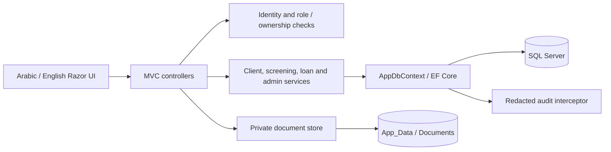

# Agricultural Loan Screening System

[](https://github.com/moaahmad01/agricultural-loan-screening-system/actions/workflows/build-and-test.yml)

An ASP.NET Core MVC application for organizing agricultural loan assessments: client records, climate-smart farming questionnaires, weighted recommendations, and repayment schedules. Applicants manage their own records; employees review applications; administrators manage staff access.

The project demonstrates server-side authorization, EF Core data modeling, financial calculations, bilingual Razor interfaces, and reproducible build tooling. It is a portfolio application and screening aid, not a certified lending decision engine.

## Implemented features

- **Client records:** self-registration, staff-created clients, profile editing, search, pagination, and prior loan/application history.
- **Climate-smart screening:** five seeded sections and 24 questions, weighted scoring, saved answers, section documents, and stored recommendations. Thresholds are 75% for eligible and 50% for eligible with conditions.
- **Loan calculations:** simple and reducing-balance interest, seven repayment frequencies, saved installment schedules, and server-selected interest rates. Principal is limited to **1–10,000,000 JOD inclusive**, numerically representable at two decimal places (trailing zeros are accepted). The browser preview is an estimate; submitted applications use server-selected rates. See [financial behavior](docs/ARCHITECTURE.md#loan-calculation-and-validation).
- **Application review:** pending, approved, and rejected applications with a staff dashboard.
- **Administration:** questionnaire sections/questions, weights, user roles, and paginated audit records. Only administrators can grant or remove employee access.
- **Arabic and English:** culture switching, RTL/LTR layouts, bilingual questionnaire content, and locally hosted assets. Some operational messages remain Arabic-first.
- **Private documents:** authenticated downloads with client ownership or staff checks; uploads outside the web root. Completed screenings reject answer/document changes.

## Technology

| Layer | Implementation |
| --- | --- |
| Web/backend | C#, ASP.NET Core 10 MVC, Razor, ASP.NET Core Identity |
| Persistence | EF Core 10, SQL Server, versioned migrations |
| Frontend | Tailwind CSS 3.4.19, JavaScript, jQuery, local Cairo/Font Awesome/SweetAlert2 assets |
| Tests | xUnit, Moq, EF Core InMemory; Docker-backed HTTP smoke and security scripts |
| Tooling | .NET 10 SDK, Node.js 24, npm/NuGet lockfiles, Docker Compose, GitHub Actions |

.NET 10 is an LTS release supported through **November 14, 2028**. This project uses SDK 10.0.402 and EF Core/Identity 10.0.13; keep SDK, runtime, and packages on supported servicing releases. See [Microsoft's support policy](https://dotnet.microsoft.com/en-us/platform/support/policy).

## CI and test evidence

[Main run 40380933455](https://github.com/moaahmad01/agricultural-loan-screening-system/actions/runs/40380933455) passed on **October 26, 2026 (UTC)** at commit `58e3a9c539f7d400905560a0831c095b624a30e1`:

| Suite | Passed |
| --- | --- |
| .NET automated tests | 161, zero failed/skipped |
| Standard HTTP smoke | 40: 32 citizen/anonymous + 8 staff |
| SEC-01 HTTP security | 42, including 18 Admin + 18 Employee checks |

These are **243 checks across three distinct suites**, not 243 .NET unit tests. Release build: **zero warnings and errors**. Node.js 24-based GitHub Actions also verify Docker builds, disposable SQL startup/migrations/reference data, HTTP readiness and antiforgery, private-volume writes, and a stability soak. Cleanup succeeded in the referenced run; TRX test results were uploaded.

This is evidence for the disposable CI environment, not a guarantee for every local or production installation. Detailed results and qualifications: [verification record](PORTFOLIO_READINESS.md#current-status).

## See the application

These are genuine captures from the running application with synthetic local data.

| Landing page | Administration |
| --- | --- |
|  |  |

The existing [screenshot guide](docs/SCREENSHOTS.md) also includes the questionnaire, stored result, and calculator captures, with their original capture context.

## Quick start

Run commands from the repository root, beside `AgriculturalLoanSystem.sln`.

```sh
git clone https://github.com/moaahmad01/agricultural-loan-screening-system.git
cd agricultural-loan-screening-system
```

### Docker local demo

Install Docker Engine or Docker Desktop with Linux containers and the Compose v2 plugin. Copy `.env.example` to `.env`, set a unique strong `DB_SA_PASSWORD`, and optionally set `INITIAL_ADMIN_PASSWORD` for first-run admin bootstrap. Never commit `.env`.

```sh
docker compose config --quiet
docker compose up --build -d
```

After SQL is healthy, the one-shot migrator exits successfully and the web service starts at [localhost:8080](http://localhost:8080). Named volumes retain the database, private documents, and Data Protection keys. Normal shutdown is `docker compose down`, which preserves those volumes.

This is a **local demo configuration** using the SQL administrator login. See [Docker setup](docs/SETUP.md#docker-local-demo) and [deployment prerequisites](docs/SETUP.md#deployment-prerequisites) before adapting it for hosting.

### Native development

Use a .NET 10 SDK compatible with `global.json` (10.0.402 or a later supported .NET 10 feature band), Node.js 24, and SQL Server; Windows LocalDB is supported. Follow the [native setup commands](docs/SETUP.md#local-development) for locked restore, CSS build, tests, connection configuration, and startup on port 5136. Development applies migrations; Production requires an explicit migration step.

## Demo walkthrough

1. Register a synthetic applicant using a unique ten-digit test identifier and a password you choose. Never use a real national ID or identity document.
2. Edit the client profile, then start a new screening.
3. Answer all five sections, optionally attaching a synthetic PDF/image before finishing.
4. Review the stored result and report; use the calculator to submit an application.
5. Sign in as the locally bootstrapped administrator to inspect pending applications, questionnaire configuration, and audit events.

Python 3 HTTP walkthroughs are documented in [disposable HTTP verification](docs/SETUP.md#disposable-http-verification). They create synthetic records and must not target valuable data. No public live demo URL is provided.

## Architecture



Services hold workflows and calculations; EF Core enforces relationships and uniqueness. Documents are retrieved by record ID through authorization checks, never by a caller-supplied disk path. [Architecture and tradeoffs](docs/ARCHITECTURE.md) explains the boundaries and remaining limitations.

## Engineering highlights

- Ownership is checked against persisted client/session records, alongside staff roles. National-ID knowledge cannot claim an existing client record.
- Documents use random storage names, a 5 MiB limit, extension/signature validation, and attachment-only downloads with `no-store`. Legacy public upload URLs are blocked.
- Global antiforgery validation covers unsafe MVC requests. Starting a screening is a POST, and login/register throttling is partitioned by remote IP.
- Submitted interest rates are recalculated on the server. Weekly and biweekly repayment dates use calendar-day intervals.
- Database constraints prevent duplicate answers and multiple loans for one screening. Migrations fail explicitly on conflicting legacy data.
- Audit entries retain actor, entity, action, timestamp, and changed field names without duplicating passwords, tokens, or personal field values.
- CI runs the .NET tests, then both HTTP suites against a disposable Docker/SQL stack. No deployment or publishing is configured.

## Documentation

- [Setup and operations](docs/SETUP.md): native/Docker startup, migrations, disposable HTTP tests, and data safety.
- [Architecture and financial behavior](docs/ARCHITECTURE.md): service boundaries, scoring, validation, and repayment reconciliation.
- [Security](docs/SECURITY.md): private data, legacy-document migration, and hosting limitations.
- [Verification record](PORTFOLIO_READINESS.md#current-status) and [audit dispositions](docs/AUDIT.md): current CI evidence and dated history.
- [Screenshots](docs/SCREENSHOTS.md) and [third-party notices](docs/THIRD_PARTY.md).

## Verification and limitations

Unit/controller/service tests use EF InMemory and mocks; Docker-backed SQL/HTTP checks supplement them. The latest verified npm CI output reported **zero vulnerabilities on October 26, 2026**; that is dated evidence, not a guarantee about future scans. Browserslist data-age and `punycode`/`url.parse()` dependency notices remain separate from the zero-warning .NET build. Node.js 20 action-runtime deprecation notices were absent.

Known limitations include partial localization, no malware scanning/storage quotas, no comprehensive browser or SQL concurrency suite, and domain-policy review for exclusionary questions and interest-rate band gaps. Historical questionnaires are not versioned; saved loan schedules are not automatically recalculated. Small-principal/long-duration repayment behavior is explained in [architecture](docs/ARCHITECTURE.md#financial-limitations). No production-readiness claim is made.

## Security, attribution, and license

Read [security and legacy-document migration](docs/SECURITY.md) before upgrading an installation that held private data. Never put private uploads, keys, database exports, or environment files in Git.

No project license has been selected. The owner confirmed permission to publish the included source, documentation, screenshots, and assets on October 22, 2026. Third-party notices are retained; see [attribution](docs/THIRD_PARTY.md).
