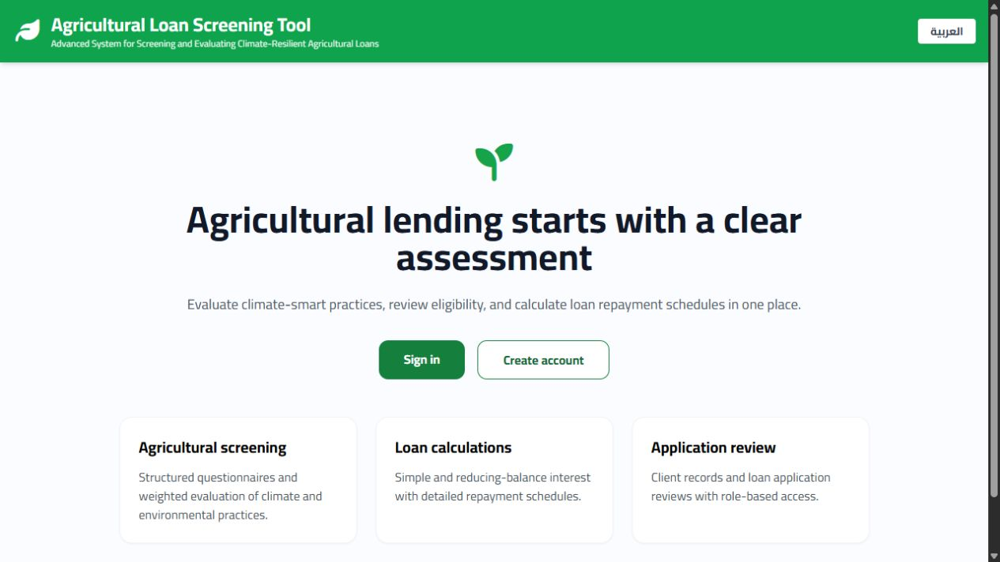
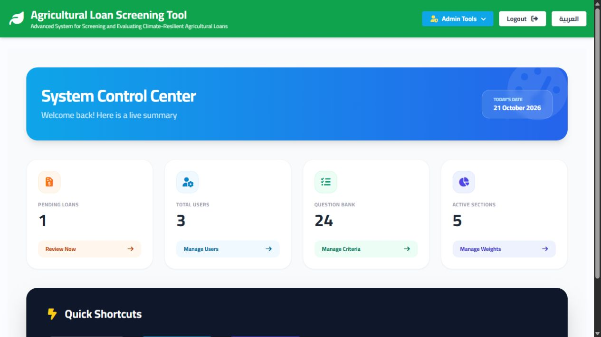
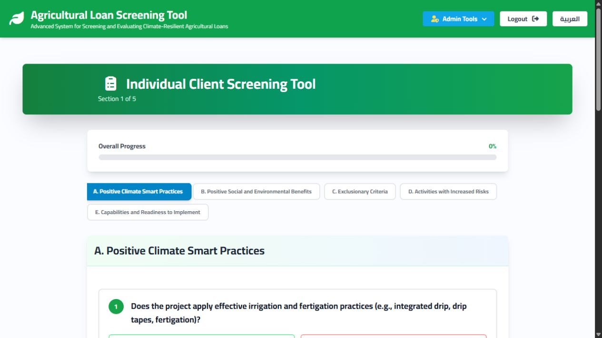
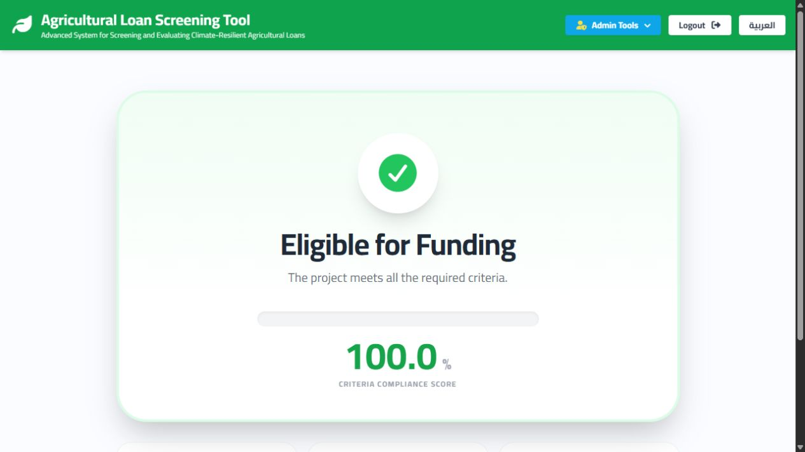
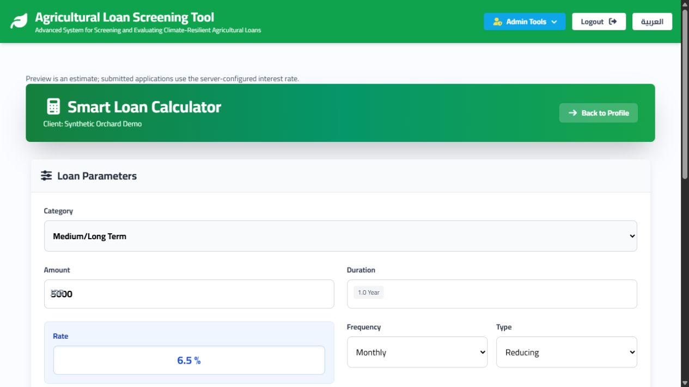
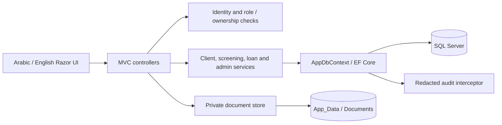

# Agricultural Loan Screening System

[](https://github.com/moaahmad01/agricultural-loan-screening-system/actions/workflows/build-and-test.yml)

An ASP.NET Core MVC application for organizing agricultural loan assessments: client records, climate-smart farming questionnaires, weighted recommendations, and repayment schedules. Applicants manage their own records; employees review applications; administrators manage staff access.

The project demonstrates server-side authorization, EF Core data modeling, financial calculations, bilingual Razor interfaces, and reproducible build tooling. It is a portfolio application and screening aid, not a certified lending decision engine.

## See the application

These are genuine captures from the running application with synthetic local data.

| Landing page | Administration |
| --- | --- |
|  |  |

| Agricultural screening | Calculated result |
| --- | --- |
|  |  |



Capture details: [screenshots](docs/SCREENSHOTS.md).

## Implemented features

- **Client records:** self-registration, staff-created clients, profile editing, search, pagination, and prior loan/application history.
- **Climate-smart screening:** five seeded sections and 24 questions, weighted scoring, saved answers, section documents, and stored recommendations. Thresholds are 75% for eligible and 50% for eligible with conditions.
- **Loan calculations:** simple and reducing-balance interest, seven repayment frequencies, saved installment schedules, and server-selected interest rates. The browser preview is an estimate.
- **Application review:** pending, approved, and rejected applications with a staff dashboard.
- **Administration:** questionnaire sections/questions, weights, user roles, and paginated audit records. Only administrators can grant or remove employee access.
- **Arabic and English:** culture switching, RTL/LTR layouts, bilingual questionnaire content, and locally hosted assets. Some operational messages remain Arabic-first.
- **Private documents:** authenticated downloads with client ownership or staff checks; uploads outside the web root. Completed screenings reject answer/document changes.

## Technology

| Layer | Implementation |
| --- | --- |
| Web/backend | C#, ASP.NET Core 9 MVC, Razor, ASP.NET Core Identity |
| Persistence | EF Core 9, SQL Server, versioned migrations |
| Frontend | Tailwind CSS 3, JavaScript, jQuery, local Cairo/Font Awesome/SweetAlert2 assets |
| Tests | xUnit, Moq, EF Core InMemory; local HTTP smoke-test script |
| Tooling | .NET 9 SDK, Node.js 24, npm/NuGet lockfiles, Docker Compose, GitHub Actions |

.NET 9 reaches end of support on **November 10, 2026**. Plan and validate a .NET 10 LTS upgrade before maintaining a public deployment beyond that date. This preparation preserves the existing major framework version. See [Microsoft's support policy](https://dotnet.microsoft.com/en-us/platform/support/policy).

## Architecture



Services hold workflows and calculations; EF Core enforces relationships and uniqueness. Documents are retrieved by record ID through authorization checks, never by a caller-supplied disk path. [Architecture and tradeoffs](docs/ARCHITECTURE.md) explains the boundaries and remaining limitations.

## Run locally

Prerequisites: a .NET 9 SDK compatible with `global.json`, Node.js 24, and SQL Server (Windows LocalDB is supported). Run commands **from the repository root, beside `AgriculturalLoanSystem.sln`**.

```sh
git clone https://github.com/moaahmad01/agricultural-loan-screening-system.git
cd agricultural-loan-screening-system
dotnet tool restore
dotnet restore AgriculturalLoanSystem.sln --locked-mode
npm ci --prefix AgriculturalLoanSystem
npm run build:css --prefix AgriculturalLoanSystem
dotnet build AgriculturalLoanSystem.sln --configuration Release --no-restore
dotnet test AgriculturalLoanSystem.sln --configuration Release --no-build
```

PowerShell example for an isolated local database:

```powershell
$env:ASPNETCORE_ENVIRONMENT = 'Development'
$env:ConnectionStrings__DefaultConnection = 'Server=(localdb)\mssqllocaldb;Database=AgriculturalLoanPortfolio;Trusted_Connection=True;TrustServerCertificate=True'
# Optional first-run administrator. Supply your own password; none is bundled.
$env:INITIAL_ADMIN_PASSWORD = [System.Net.NetworkCredential]::new('', (Read-Host 'Initial admin password' -AsSecureString)).Password
dotnet run --project AgriculturalLoanSystem --configuration Release --no-build --launch-profile http
```

Open [localhost:5136](http://localhost:5136). Development startup applies migrations and seeds questionnaire/rate configuration and roles. It does **not** seed customer records. If supplied on first run, the administrator username is `admin`; remove `INITIAL_ADMIN_PASSWORD` after bootstrap. Register a separate synthetic applicant to try the complete workflow.

For SQL Server credentials, HTTPS, explicit migrations, and existing installations, see [setup](docs/SETUP.md).

## Run with Docker

```sh
# Copy .env.example to .env and set a unique DB_SA_PASSWORD.
# Set INITIAL_ADMIN_PASSWORD only if an initial admin account is needed.
docker compose config --quiet
docker compose up --build -d
```

Open [localhost:8080](http://localhost:8080). Compose binds SQL and HTTP to loopback, persists database/private-document/key volumes, waits for SQL health, and runs a separate migrator before the web application. This is a **local demo configuration**, using the SQL administrator login; it is not a public deployment configuration. Container execution could not be verified here because Docker's Linux engine was stopped. See [deployment prerequisites](docs/SETUP.md#deployment-prerequisites).

## Demo walkthrough

1. Register a synthetic applicant using a unique ten-digit test identifier and a password you choose. Never use a real national ID or identity document.
2. Edit the client profile, then start a new screening.
3. Answer all five sections, optionally attaching a synthetic PDF/image before finishing.
4. Review the stored result and report; use the calculator to submit an application.
5. Sign in as the locally bootstrapped administrator to inspect pending applications, questionnaire configuration, and audit events.

An automated local walkthrough is available with Python 3:

```sh
python scripts/smoke_test.py --allow-synthetic-data
```

Use it only with a local database dedicated to synthetic data. It creates accounts, screenings, and a loan; records are retained for inspection. Optional `DEMO_ADMIN_PASSWORD` enables staff checks. There is **no hosted public demo**; GitHub contains source, not a running database-backed application.

## Engineering highlights

- Ownership is checked against persisted client/session records, alongside staff roles. National-ID knowledge cannot claim an existing client record.
- Documents use random storage names, a 5 MiB limit, extension/signature validation, and attachment-only downloads with `no-store`. Legacy public upload URLs are blocked.
- Global antiforgery validation covers unsafe MVC requests. Starting a screening is a POST, and login/register throttling is partitioned by remote IP.
- Submitted interest rates are recalculated on the server. Weekly and biweekly repayment dates use calendar-day intervals.
- Database constraints prevent duplicate answers and multiple loans for one screening. Migrations fail explicitly on conflicting legacy data.
- Audit entries retain actor, entity, action, timestamp, and changed field names without duplicating passwords, tokens, or personal field values.
- CI builds frontend assets and the Release solution, runs tests, checks the migration snapshot, and validates Compose configuration. No deployment or publishing is configured.

## Verification and limitations

The final verification record is [PORTFOLIO_READINESS.md](PORTFOLIO_READINESS.md). Unit/service tests use EF InMemory and do not substitute for SQL Server constraints; local HTTP and SQL checks supplement them.

Known limitations include build-time Tailwind 3 dependency advisories; the upcoming .NET support deadline; no malware scanning/storage quotas; partial localization; no automated browser suite; and domain-policy review still needed for exclusionary questions, interest-rate band gaps, and payment rounding. Historical questionnaire text/weights are not versioned. No production-readiness claim is made.

Next priorities: upgrade the framework and Tailwind toolchain; replace the duplicate browser calculator with a server-backed preview; version questionnaire policy; add SQL concurrency/browser CI tests; and implement verified invitations for existing staff-created clients.

## Security, attribution, and license

Read [security and legacy-document migration](docs/SECURITY.md) before upgrading an installation that held private data. Never put private uploads, keys, database exports, or environment files in Git.

No project license has been selected. The owner confirmed permission to publish the included source, documentation, screenshots, and assets on October 22, 2026. Third-party notices are retained; see [attribution](docs/THIRD_PARTY.md).
