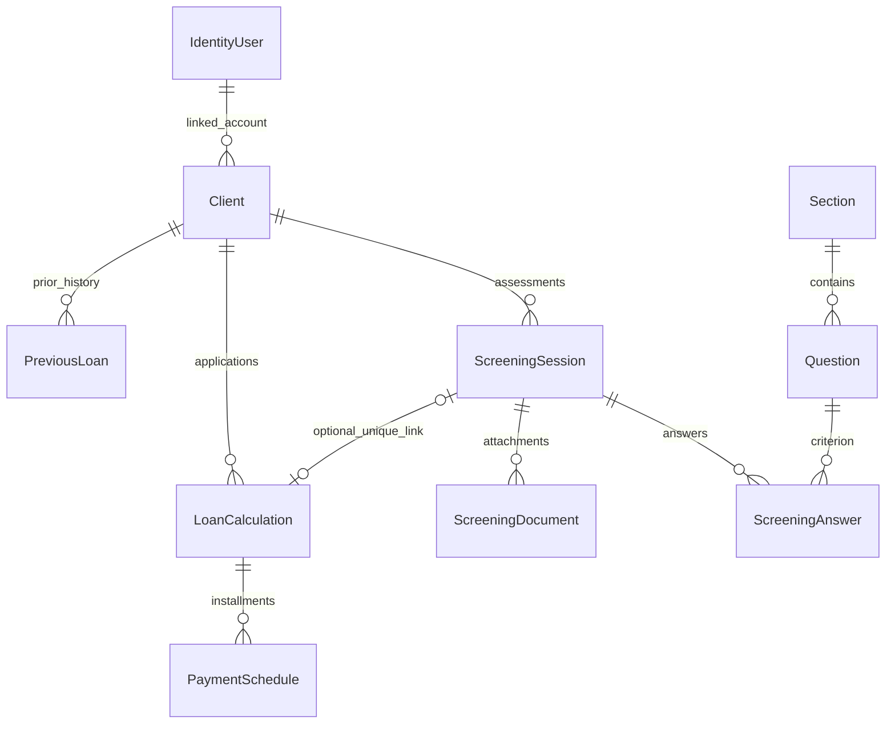

# Architecture

## Request and data flow

The application remains one MVC web project and one test project. Razor views submit to controllers; most controllers delegate to injected service interfaces/implementations. `AppDbContext` extends `IdentityDbContext<IdentityUser>`. `HomeController` retains a small direct client lookup for role-based navigation; there is no claim of strict clean-architecture isolation.

| Component | Responsibility |
| --- | --- |
| AccountController / Identity | Registration, password sign-in, lockout, logout, Citizen role assignment |
| ClientsService | Client creation, profile updates, search, history aggregation |
| ScreeningService | Questionnaire loading/cache, answers, completeness, scoring, document metadata |
| LoanCalculationService | Interest-rate lookup and simple/reducing installment schedules |
| LoansService | Persist applications/schedules; verify session/client relationship |
| AdminService | Questionnaire changes, review status, dashboard, audit queries |
| DocumentsController / PrivateDocumentStore | Ownership-checked attachment downloads and constrained private disk storage |
| AuditInterceptor | Change metadata, with all property values redacted |

Controllers apply role/ownership rules; services apply workflow invariants. New entry points must apply authorization explicitly. Services are not independently authenticated APIs.

## Data relationships

National IDs are unique. Answers are unique by session/question. A filtered unique loan/session index permits independent loans with no screening link, while preventing two applications for one linked session. Question/section deletion uses restrictions and soft deactivation to preserve referenced records. The model still allows multiple client rows per Identity user; standard registration creates one.

## Scoring and financial behavior

For each answered section, Yes points divided by possible points are multiplied by its weight. The sum is normalized by total contributing weight. At least 75 is eligible, at least 50 is conditional, and lower scores are not eligible. Seeded weights are 20, 25, 25, 30, and 0. These policies are preserved, not endorsed as a validated credit model: exclusionary/risk questions currently use the same positive Yes scoring and require domain review.

Finalization requires all active questions. Completed, abandoned, or loan-linked screenings reject further answer changes; document mutations are also rejected. Linked screenings cannot be deleted. This is application-level protection, not a proof against every concurrent operation. Questionnaire definitions remain mutable: historical reports can display later edits. Snapshot/versioning and SQL-backed race tests remain future work.

### Loan calculation and validation

Supported calculations are simple interest (principal × annual rate × years) and reducing-balance amortization, including the zero-rate case. `Murabaha` exists in the enum but has no distinct finance implementation and is not advertised as supported.

MVC validates principal using decimal comparisons against **1–10,000,000 JOD, inclusive**, plus a precision rule: the value must equal its two-decimal rounding. This rejects meaningful fractional digits beyond two places rather than silently accepting a rounded principal. Numerically equivalent trailing zeros are allowed (`1000.000` is valid precision; `1000.001` is not). See [LoanInputModel](../AgriculturalLoanSystem/Services/Models/LoanCalculationDtos.cs) and [LoanPrincipalPrecision](../AgriculturalLoanSystem/Services/Models/LoanPrincipalPrecision.cs).

For application submission, `LoansController` selects the rate from the server's configured bands and replaces the submitted rate before calculating and saving. Rate-table gaps fall back to 9%; the browser estimate has separate thresholds and can differ. Saved applications retain the authoritative rate used at creation.

Payment count is the ceiling of years × payments per year. Supported frequencies are weekly, biweekly, monthly, every two months, quarterly, semiannual, and annual. Weekly/biweekly dates advance 7/14 days; other frequencies use calendar months.

### Repayment reconciliation

`LoanCalculationService` uses two-decimal amounts with **`MidpointRounding.ToEven`** (banker's rounding). The nominal installment is rounded from the formula. Reducing-balance period interest is calculated from the rounded outstanding balance; simple-interest period interest is allocated from the formula's total.

Each row's payment equals principal paid plus interest paid. Principal allocation is bounded between zero and the remaining balance; the final row pays the remaining principal. For simple interest, the final interest allocation reconciles to the rounded total-interest target. If earlier rounded allocations exceed that target, interest is reduced from earlier rows in reverse order, with their payments adjusted accordingly. The resulting schedule's interest and payment sums provide the summary totals; the nominal installment can differ from an adjusted row.

`LoansService` saves the rate, amounts, and generated schedule together as a new application. Reading a saved application loads those persisted rows; existing historical schedules are **not automatically recalculated or rewritten** by the current calculation code.

### Financial limitations

- Very small principal over long durations can produce zero-valued ordinary installments and a larger final payment. Regression tests cover cases such as 1 JOD at zero interest over 600 monthly payments; reconciliation is not a guarantee of a commercially suitable repayment policy.
- MVC model validation and internal service boundaries differ. `LoansService` defensively checks principal precision and client/session linkage, but direct service calls do not automatically run all MVC range/enum validation. `CalculateLoan` also accepts its supplied rate; server-authoritative rate selection occurs in the controller submission path.
- The browser preview is an estimate, not the saved schedule or an authoritative rate quote. Domain review of rate-band gaps, extreme repayment cases, and screening policy remains separate from arithmetic regression coverage.

## Operational boundaries

- Documents live under `App_Data/Documents`; database fields store keys. Legacy `/uploads/...` values resolve to the private location after offline copying. No public fallback exists.
- File/database operations are not a distributed transaction. Failed saves or session deletion can leave private orphan files; retention/reconciliation needs operational handling.
- Caches are per process. Admin questionnaire mutations invalidate that cache; direct rate-table changes can take up to 30 minutes to appear.
- Audit records are application history, not tamper-proof compliance logs. Added entities may have temporary IDs at interceptor time. Values are deliberately omitted to protect personal data.
- Production migrations are explicit; reference-data seeding still runs at startup. Multiple replicas and reference-data reconciliation need a deployment design before scaling.
