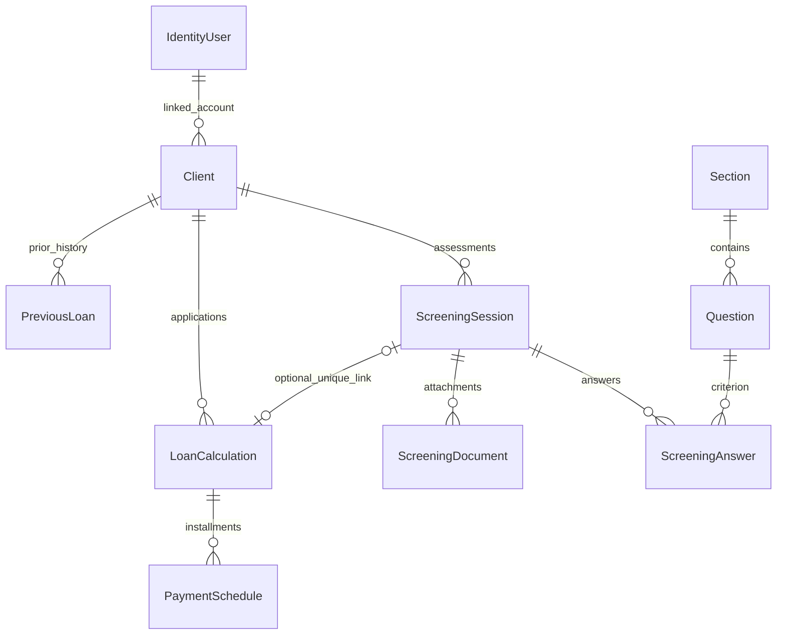

# Architecture

## Request and data flow

The application remains one MVC web project and one test project. Razor views submit to controllers; most controllers delegate to injected service interfaces/implementations. `AppDbContext` extends `IdentityDbContext<IdentityUser>`. `HomeController` retains a small direct client lookup for role-based navigation; there is no claim of strict clean-architecture isolation.

| Component | Responsibility |
| --- | --- |
| AccountController / Identity | Registration, password sign-in, lockout, logout, Citizen role assignment |
| ClientsService | Client creation, profile updates, search, history aggregation |
| ScreeningService | Questionnaire loading/cache, answers, completeness, scoring, document metadata |
| LoanCalculationService | Interest-rate lookup and simple/reducing installment schedules |
| LoansService | Persist applications/schedules; verify session/client relationship |
| AdminService | Questionnaire changes, review status, dashboard, audit queries |
| DocumentsController / PrivateDocumentStore | Ownership-checked attachment downloads and constrained private disk storage |
| AuditInterceptor | Change metadata, with all property values redacted |

Controllers apply role/ownership rules; services apply workflow invariants. New entry points must apply authorization explicitly. Services are not independently authenticated APIs.

## Data relationships

National IDs are unique. Answers are unique by session/question. A filtered unique loan/session index permits independent loans with no screening link, while preventing two applications for one linked session. Question/section deletion uses restrictions and soft deactivation to preserve referenced records. The model still allows multiple client rows per Identity user; standard registration creates one.

## Scoring and financial behavior

For each answered section, Yes points divided by possible points are multiplied by its weight. The sum is normalized by total contributing weight. At least 75 is eligible, at least 50 is conditional, and lower scores are not eligible. Seeded weights are 20, 25, 25, 30, and 0. These policies are preserved, not endorsed as a validated credit model: exclusionary/risk questions currently use the same positive Yes scoring and require domain review.

Finalization requires all active questions. Completed, abandoned, or loan-linked screenings reject further answer changes; document mutations are also rejected. Linked screenings cannot be deleted. This is application-level protection, not a proof against every concurrent operation. Questionnaire definitions remain mutable: historical reports can display later edits. Snapshot/versioning and SQL-backed race tests remain future work.

Simple interest uses principal × annual rate × years; reducing interest uses amortized installments. Payment count is the ceiling of years × payments per year. Weekly/biweekly dates advance 7/14 days; other frequencies use calendar months. Monetary outputs retain the original two-decimal rounding. Rate-table gaps fall back to 9%; the JavaScript estimate has separate thresholds and may differ. `Murabaha` exists in the enum but has no distinct finance implementation and is not advertised as supported.

## Operational boundaries

- Documents live under `App_Data/Documents`; database fields store keys. Legacy `/uploads/...` values resolve to the private location after offline copying. No public fallback exists.
- File/database operations are not a distributed transaction. Failed saves or session deletion can leave private orphan files; retention/reconciliation needs operational handling.
- Caches are per process. Admin questionnaire mutations invalidate that cache; direct rate-table changes can take up to 30 minutes to appear.
- Audit records are application history, not tamper-proof compliance logs. Added entities may have temporary IDs at interceptor time. Values are deliberately omitted to protect personal data.
- Production migrations are explicit; reference-data seeding still runs at startup. Multiple replicas and reference-data reconciliation need a deployment design before scaling.
